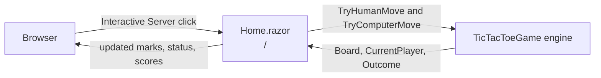

# Route: 001 tic-tac-toe

Navigator | Drafted: 2026-11-21 | Approved by: Captain (name not provided), 2026-11-21

## Approach

Create one small .NET 10 ASP.NET Core web application in a new `TicTacToe/` project and add framework-provided Blazor Interactive Server components. Use the minimal `dotnet new web` host rather than the larger Blazor sample template so the change adds only files needed for the host, root components, game page, and pure game engine. The repository has no application to extend. [.flightcrew/survey/baseline.md]

The page owns the board UI and three session counters. The counters live in the page component for the lifetime of the browser circuit; they are intentionally not stored in a database or browser storage. A user click on an empty cell calls a game-engine method, then the engine applies the O optimal move when the game remains in progress. The engine is also independently testable without a browser. [flightplan.md R1-R7]



## Components

| Component | New / Changed | Path | Serves (R#) |
|---|---|---|---|
| ASP.NET Core project and host | New | `TicTacToe/TicTacToe.csproj`; `TicTacToe/Program.cs`; `TicTacToe/appsettings.json`; `TicTacToe/appsettings.Development.json`; `TicTacToe/Properties/launchSettings.json` | R1-R7 |
| Blazor Interactive Server root | New | `TicTacToe/Components/App.razor`; `TicTacToe/Components/Routes.razor`; `TicTacToe/Components/_Imports.razor` | R1-R7 |
| Game page and 3-by-3 UI | New | `TicTacToe/Components/Pages/Home.razor`; `TicTacToe/Components/Pages/Home.razor.css` | R1-R7 |
| Pure game engine and public types | New | `TicTacToe/Services/TicTacToeGame.cs` | R1-R6 |
| Automated test project | New (package approval granted) | `TicTacToe.Tests/TicTacToe.Tests.csproj`; `TicTacToe.Tests/TicTacToeGameTests.cs`; `TicTacToe.Tests/TicTacToePageTests.cs` | R1-R7 |
| Ops manual technology standards and quality gates | Changed | `.flightcrew/manual.md` | R1-R7 |

## Interfaces and contracts

### Application route and UI

- Public route: `/`
- Render mode: `InteractiveServer`.
- `Home.razor` serves `/` and renders exactly nine buttons with stable labels `cell-0` through `cell-8`.
- `cell-0` is top-left and `cell-8` is bottom-right. Rows are indices `0-2`, `3-5`, and `6-8`; columns are `0,3,6`, `1,4,7`, and `2,5,8`.
- The text status contract is exactly one of:
  - `Current player: X`
  - `Current player: O`
  - `Winner: X`
  - `Winner: O`
  - `Draw`
- A human move handler is attached to each button. A disabled or occupied cell produces no state change.
- Rematch is exposed by a button labeled `Rematch`; it is shown for every finished game and calls `Reset()`. The UI also renders labels exactly `Human wins: <count>`, `Computer wins: <count>`, and `Draws: <count>`.

### Pure engine public contract

The engine in `TicTacToe/Services/TicTacToeGame.cs` has this exact public shape:

```csharp
namespace TicTacToe.Services;

public enum Mark { Empty, X, O }
public enum GameOutcome { InProgress, XWins, OWins, Draw }
```

The public engine surface is `IReadOnlyList<Mark> Board`, `Mark CurrentPlayer`, `GameOutcome Outcome`, `bool TryHumanMove(int cell)`, `bool TryComputerMove()`, and `void Reset()`. The move methods return `true` only when they apply a legal move; otherwise they return `false` without changing state.

Exact behavior:

- `Board` has exactly nine entries, in row-major order. Every entry is `Empty`, `X`, or `O`.
- New games and `Reset()` set every entry to `Empty`, set `CurrentPlayer` to `X`, and set `Outcome` to `InProgress`.
- `TryHumanMove(cell)` returns `true` only when `Outcome == InProgress`, `CurrentPlayer == X`, `cell` is in `[0,8]`, and `Board[cell] == Empty`; it then sets that entry to `X`. It otherwise returns `false` and changes no property.
- After a valid human move, the engine evaluates `Outcome`; if still in progress it sets `CurrentPlayer` to `O`, otherwise it leaves `CurrentPlayer` as `X`.
- `TryComputerMove()` returns `true` only when `Outcome == InProgress`, `CurrentPlayer == O`, and at least one board entry is `Empty`; it chooses one empty entry with minimax and places `O`. It otherwise returns `false` and changes no property.
- After a valid computer move, the engine evaluates `Outcome`; if still in progress it sets `CurrentPlayer` to `X`, otherwise it leaves `CurrentPlayer` as `O`.
- `Outcome == XWins` or `OWins` after a complete row, column, or diagonal of the matching mark. `Outcome == Draw` only when the board is full and no mark has won.
- Once `Outcome` is not `InProgress`, all move methods return `false` and make no change.
- `TryComputerMove()` uses complete minimax search. Terminal scores are: O win `10 - depth`, X win `depth - 10`, draw `0`; it maximizes for O and minimizes for X. It chooses only from legal empty moves, and a tie may use the lower index. This guarantees O cannot lose and will take a forced win.
- The engine uses an internal static `GameOutcome EvaluateOutcome(IReadOnlyList<Mark> board)` helper for line and draw detection. It is not part of the public game API; the same source file grants `TicTacToe.Tests` internal access with `InternalsVisibleTo`, allowing tests to cover X and O wins for every line without adding a public state-mutation method.

### Session data contract

The page component owns these exact private fields:

```csharp
private int humanWins;
private int computerWins;
private int draws;
```

- A finished move increments exactly one matching counter: `Outcome.XWins` increments `humanWins`, `Outcome.OWins` increments `computerWins`, and `Outcome.Draw` increments `draws`.
- The counter is incremented once only because only the transition from an in-progress game to a finished game can record the result.
- `Reset()` clears the engine board and `CurrentPlayer`; it does not modify `humanWins`, `computerWins`, or `draws`.

No public HTTP, event, database, queue, or file contract is added.

## Data changes

- Migrations: none.
- Backfills: none.
- Rollback plan: no persistent data or migrations need reversal. If rollback is approved, remove only files added by this flight under `TicTacToe/` and `TicTacToe.Tests/`; do not restore or delete any pre-existing files. File deletion requires captain approval under the ops manual.

## Platform changes

- Add a .NET 10 ASP.NET Core project targeting `net10.0`; locally available SDKs are 9.0.308 and 10.0.101.
- Create the five-file host without automatic restore using `dotnet new web --name TicTacToe --output TicTacToe --framework net10.0 --no-restore`; this minimal template was verified locally. Add Razor Components and Interactive Server using the installed .NET 10 shared framework.
- `TicTacToe/Program.cs` registers `AddRazorComponents().AddInteractiveServerComponents()`, maps static assets, maps Razor components, and enables interactive server rendering.
- Use framework-provided Razor Components, SignalR infrastructure, and Blazor rendering only. No NuGet package beyond framework assets is required for the application.
- No configuration key, secret, external service, infrastructure resource, CI workflow, or persisted production setting is proposed. No secret names are needed.

## Testing strategy

| Acceptance check | Test type | Test location |
|---|---|---|
| AC1 (R1) | Component rendering test: assert nine empty buttons, route status `Current player: X`, and X first | `TicTacToe.Tests/TicTacToePageTests.cs` |
| AC2 (R2) | Engine and component interaction test: select an empty button and assert X in that exact cell | `TicTacToe.Tests/TicTacToeGameTests.cs`; `TicTacToe.Tests/TicTacToePageTests.cs` |
| AC3 (R3) | Engine and component interaction test: assert one `O` is placed in an empty cell after the computer turn | `TicTacToe.Tests/TicTacToeGameTests.cs`; `TicTacToe.Tests/TicTacToePageTests.cs` |
| AC4 (R3) | Exhaustive minimax test: enumerate every legal human move sequence against `TryComputerMove()` and assert no X winner, with an O winner whenever O can force it | `TicTacToe.Tests/TicTacToeGameTests.cs` |
| AC5 (R4) | Engine and component interaction test: select an occupied button and assert board and `CurrentPlayer` are unchanged | `TicTacToe.Tests/TicTacToeGameTests.cs`; `TicTacToe.Tests/TicTacToePageTests.cs` |
| AC6 (R5) | Engine table tests call the internal outcome evaluator for all rows, columns, and diagonals for X and O; component tests verify winner status and that later moves do not change the game | `TicTacToe.Tests/TicTacToeGameTests.cs`; `TicTacToe.Tests/TicTacToePageTests.cs` |
| AC7 (R6) | Engine and component test: fill the final empty cell in a no-win board and assert `Draw` with no later move changes | `TicTacToe.Tests/TicTacToeGameTests.cs`; `TicTacToe.Tests/TicTacToePageTests.cs` |
| AC8 (R7) | Component outcome tests: finish X win, O win, and draw cases and assert only the matching private score increases once | `TicTacToe.Tests/TicTacToePageTests.cs` |
| AC9 (R7) | Component interaction test: after completed game plus known scores, click `Rematch` and assert all nine empty, X current, and all scores unchanged | `TicTacToe.Tests/TicTacToePageTests.cs` |

Verification commands for implementation, after the test project is approved and restored:

- `dotnet build TicTacToe/TicTacToe.csproj`
- `dotnet test TicTacToe.Tests/TicTacToe.Tests.csproj`
- `git diff --check`
- `dotnet run --project TicTacToe/TicTacToe.csproj`, then manually check `/` for initial render, X/O turns, finish/rematch, and occupied-cell no-op behavior

The repository currently has no test framework or test files. [.flightcrew/survey/baseline.md] The captain approved the listed test packages; no other package dependencies are in scope. [.flightcrew/manual.md; Guardrails]

Before landing, update `.flightcrew/manual.md` to record C#/.NET 10 with Blazor Interactive Server and the exact build, test, and manual verification commands above, as required by its Quality gates and Tech standards sections.

## Risks

| Risk | Likelihood | Impact | Mitigation |
|---|---|---|---|
| Starting a new app from a modern template produces framework template churn or an SDK mismatch | Medium | Medium | Target `net10.0` with locally confirmed SDK 10.0.101, use only documented framework APIs, and keep to one project plus one test project. |
| Blazor circuit state can be lost on browser reload or circuit loss | Medium | Low | Scope retention explicitly to the rematch lifetime and browser circuit, match the in-scope requirement that scores are not persisted between browser sessions, and do not add storage. |
| Minimax implementation can miss a terminal state or be slow due to full game trees | Low | High | Use immutable board copies or index-only recursion, evaluate terminal states before generating moves, and prove every legal sequence in exhaustive tests. |
| After a human move, the server could render before the computer has moved | Low | Medium | Handle the human move synchronously: apply X, evaluate, then call `TryComputerMove()` once O is current and let one render show the final state. |
| Score recording could increment on remount or on every move | Low | Medium | Record exactly inside the transition that produced a finished outcome and guard every move through `Outcome == InProgress`. |
| Test package restoration is unavailable or violates repository guardrails | Medium | Medium | Restore only the approved package IDs, avoid additional dependencies, and run the test suite after restore. |

## Alternatives considered

1. **Full Blazor Web App sample template**: rejected because it creates unused sample and reconnect pages; the minimal ASP.NET Core host keeps the change focused while using framework-provided Interactive Server support.
2. **JavaScript/WASM standalone game**: rejected because the technical note requests Blazor Server and Interactive Server provides the required browser interactivity without third-party application packages.
3. **One component with private board arrays and no separate engine**: rejected because it would make exhaustive optimal-play testing and win/draw logic harder to verify; the small pure engine keeps UI and rules separable.
4. **Scoped server-side game service shared by components**: rejected because only one page needs state and a page-owned circuit state is smaller, while a service could accidentally share games across users.
5. **Persist scores with browser storage or a database**: rejected because the plan requires scores for the current browser session and explicitly excludes persistence between browser sessions.

## Exceptions

- **APPROVED BY CAPTAIN (2026-11-21)**: Add and restore `Microsoft.NET.Test.Sdk`, `xunit`, `xunit.runner.visualstudio`, and `bunit` for `TicTacToe.Tests/` to support the planned engine and component acceptance tests. No other third-party packages are approved. Blazor Server itself uses framework-provided assets. [.flightcrew/manual.md; Guardrails]
- **APPROVED BY CAPTAIN (2026-11-21)**: Add the nonpublic `EvaluateOutcome` test seam and `InternalsVisibleTo("TicTacToe.Tests")` in `TicTacToe/Services/TicTacToeGame.cs`; do not expand the public game API. This enables all R5/AC6 win-line cases to be tested despite optimal O play.
